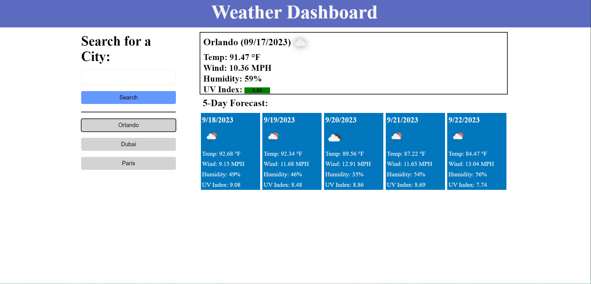
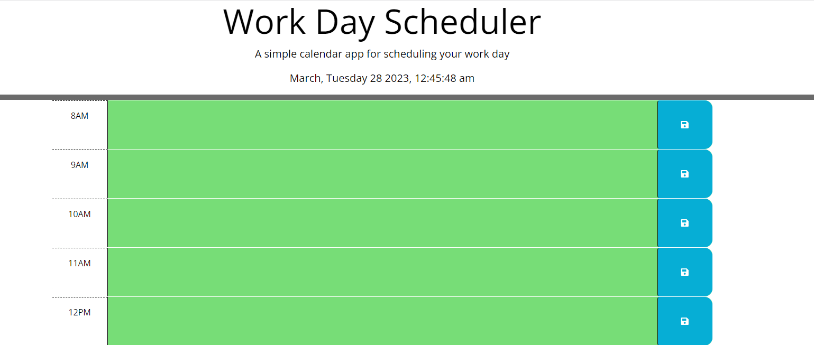

# Gerard Del Vecchio · Software portfolio

I built this portfolio in React during the University of Central Florida’s 2023 full-stack coding boot camp. It brings together eight projects, from a JavaScript quiz to a full-stack application for finding recipes.

[Open the portfolio](https://gdel-j.github.io/React-Listen-Port-Folio/)

## Selected work

| Weather Dashboard | Work Day Scheduler |
| --- | --- |
| [](https://github.com/Gdel-J/Weather-Dashboard) | [](https://github.com/Gdel-J/Work-day-Scheduler) |
| Search by city for current conditions and a five-day forecast. | Plan a working day in hourly time blocks. |

The portfolio’s project cards link to the original repositories, including the teams behind the collaborative projects. The [project list](src/components/Portfolio.js) contains the descriptions and links for all eight.

## Run locally

```sh
git clone https://github.com/Gdel-J/React-Listen-Port-Folio.git
cd React-Listen-Port-Folio
npm ci
npm start
```

Open [localhost:3000](http://localhost:3000) in your browser. Run `npm run build` to create the production site in `build/`.

[MIT license](LICENSE)
